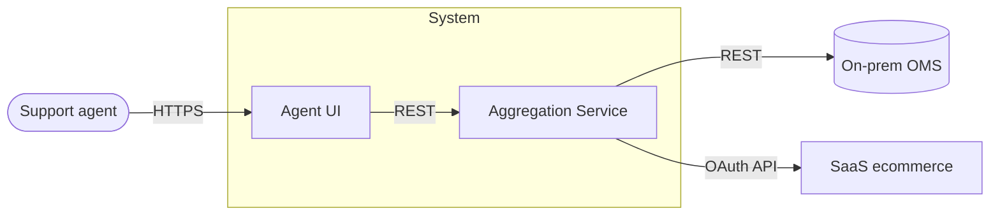

# Arch Analysis

Produce an architecture diagram and a concise analysis of a system, either an existing codebase or a design the user describes.

## 1. Gather context

- **Existing codebase:** look at the entry points, service and module boundaries, config, infrastructure files (Dockerfiles, Terraform, CI, compose files), and outbound calls (HTTP clients, queues, databases, third-party SDKs). Base the analysis on what the code actually does, not what the folder names suggest.
- **Described design:** work from what the user gives you. If key facts are missing (users, external systems, data stores, scale), ask briefly before drawing rather than inventing them.
- Label anything you infer but couldn't confirm as an **assumption**.

## 2. Draw the diagram

Use a Mermaid `flowchart` so it renders in GitHub and most markdown viewers.

- Show users and actors, the system's own components, data stores, and external systems.
- Label every edge with what flows across it, such as `REST`, `events`, or `nightly batch`, and make it sync or async where that matters.
- Group the system's own components in a `subgraph` so the boundary is obvious.
- Keep it to one readable level, roughly 15 nodes or fewer. If it gets bigger, draw a context diagram first and offer more detailed diagrams per area.

## 3. Write the analysis

Under the diagram, add these sections and keep each one short:

- **Summary:** what the system does and its overall shape, in 2–3 sentences.
- **Components:** one line per component describing what it owns.
- **Key flows:** the 1–3 most important request or data paths, step by step.
- **Risks and concerns:** single points of failure, tight coupling, missing timeouts or retries, data consistency, security boundaries, and scaling limits. Tie each one to a specific component or edge.
- **Assumptions and open questions:** anything you inferred or need confirmed.

## 4. Point to next steps

If the analysis leads to a decision or a redesign, point the user to the matching prompt in this repo:

- Unclear requirements: `prompts/01-requirements-capture.md`
- Choosing between approaches: `prompts/02-options-analysis.md`
- Recording a decision: `prompts/03-architecture-decision-record.md`
- Writing up the full design: `prompts/04-solution-design-doc.md`
